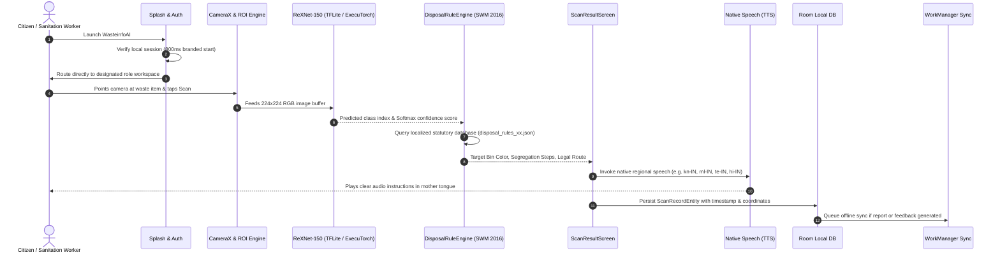

# WasteinfoAI

### Offline AI-Powered Waste Identification, Recycling & Smart Sanitation Platform
**Bharat AI-SoC Challenge 2026–27 | Theme: Environment & Climate**

[](https://kotlinlang.org)
[-3DDC84?logo=android&logoColor=white)](https://developer.android.com)
[](https://developer.android.com/jetpack/compose)
[](https://pytorch.org/executorch)
[-FF6F00?logo=tensorflow&logoColor=white)](https://www.tensorflow.org/lite)
[](https://fastapi.tiangolo.com)
[](https://github.com/chandumaddula/WasteinfoAI)
[](LICENSE)

---

## Executive Summary

**WasteinfoAI** is a mobile-first, privacy-preserving, edge-computed artificial intelligence platform engineered to eliminate municipal solid waste mis-segregation at source. Developed with zero-cloud dependencies for core vision classification and disposal advisory, the platform pairs an **INT8-quantized ReXNet-150** deep neural network with an on-device statutory rules engine strictly aligned with the **India Solid Waste Management Rules (2016)**, **E-Waste Management Rules (2022)**, and **Plastic Waste Management Rules (2016)**.

The application delivers **sub-65ms multi-item visual identification**, automated **5-color bin classification** (Green, Blue, Orange, Red, Black), localized native **Text-to-Speech (TTS) audio guidance in 9 Indian languages** (English, Hindi, Telugu, Tamil, Marathi, Kannada, Malayalam, Bengali, Gujarati), on-device conversational guidance through **Bottle AI** (combining **Meta LLaMA 3.2 via ExecuTorch** and deterministic fallbacks), and geospatial waste accumulation hotspot reporting with resilient offline synchronization.

---

## Table of Contents

- [Problem Statement & Background](#problem-statement--background)
- [Core Concept & Solution](#core-concept--solution)
- [Statutory 5-Bin Waste Classification](#statutory-5-bin-waste-classification)
- [Supported Languages (9 Indian Languages)](#supported-languages-9-indian-languages)
- [Key Features](#key-features)
- [System Architecture](#system-architecture)
- [AI & Technology Stack](#ai--technology-stack)
- [Role-Based Workspaces & Dashboards](#role-based-workspaces--dashboards)
- [System Workflow](#system-workflow)
- [Offline-First Architecture & Sync](#offline-first-architecture--sync)
- [Repository Structure](#repository-structure)
- [Installation & Setup](#installation--setup)
- [Testing & Quality Assurance](#testing--quality-assurance)
- [Bharat AI-SoC Challenge Compliance](#bharat-ai-soc-challenge-compliance)
- [Responsible AI & Data Privacy](#responsible-ai--data-privacy)
- [Contributing & License](#contributing--license)

---

## Problem Statement & Background

### The Ground Reality
India generates over **62 million tonnes of municipal solid waste annually**, with less than **25% processed or recycled**. The root bottleneck is the failure of **segregation at the source**:
- **Wet organic waste** cross-contaminates dry paper and cardboard in mixed bins, destroying recyclability.
- **Toxic heavy metals** (lead, cadmium, mercury) from unsegregated electronic waste and batteries leach into groundwater from unsanitary dumps.
- **Sanitation workers and ragpickers** face hazardous occupational conditions manually sorting broken glass, medical waste, and sharp debris.
- **Public waste accumulation** often goes unreported or untracked due to the lack of an easy municipal coordination mechanism.

### Existing Limitations Addressed
| Conventional Approach | Operational Failure / Bottleneck | WasteinfoAI Solution |
| :--- | :--- | :--- |
| **Cloud Vision APIs** | High latency (2–6s), total failure in low-connectivity zones, recurring server API costs. | **100% on-device ReXNet-150 (INT8)** inference in <65ms with zero internet dependency. |
| **English-Only Text Portals** | Complex civic PDF rulebooks inaccessible to sanitation workers and non-English speakers. | **Native regional voice output (TTS)** speaking clear instructions across **9 Indian languages** (en, hi, te, ta, mr, kn, ml, bn, gu). |
| **Generic Single-Item Models** | Confusion when scanning cluttered, real-world scenes with multiple discarded items. | **OpenCV contour ROI bounding box proposals** detecting up to 3 waste objects per frame. |
| **Ambiguous Labels** | Outputs generic labels (`"bottle"`, `"cardboard"`) without disposal instructions. | **Direct statutory rules engine binding** mapping items to civic colored bins and legal preparation methods. |
| **Fragile Network Sync** | Reports and offline work lost during intermittent internet connections. | **AndroidX WorkManager SQLite sync queue** with manual and automatic background synchronization. |

---

## Core Concept & Solution

```
Capture Image / Barcode ──► Multi-Item ROI Extraction ──► ReXNet-150 Edge Inference
                                                                  │
                                                                  ▼
          Disposal Action & Bin Assignment ◄── Statutory Rule Engine (SWM 2016)
                         │
                         ├─► Visual 5-Bin Color Card (Green, Blue, Orange, Red, Black)
                         ├─► Multilingual Voice Guidance (9 Indian Languages)
                         ├─► Bottle AI Mascot Advisory (LLaMA via ExecuTorch + Offline Engine)
                         └─► Local Room Database Cache ──► Resilient WorkManager Cloud Sync
```

WasteinfoAI puts an intelligent, multilingual waste segregation expert in the pocket of every citizen, student, sanitation worker, and facility manager. Point the smartphone camera at any discarded item to instantly receive:
1. **Predicted Waste Category & Specific Identity** (e.g., `PET Bottle`, `Li-ion Battery`, `Vegetable Scraps`).
2. **Statutory Colored Bin Assignment** (Green, Blue, Orange, Red, or Black).
3. **Item Preparation Instructions** (e.g., *empty fluids, flatten cardboard, tape battery terminals*).
4. **Environmental Impact & Recycling Route** (e.g., *home composting, plastic shredding facility*).
5. **Spoken Voice Assistance** in the user's preferred Indian language.

---

## Statutory 5-Bin Waste Classification

WasteinfoAI implements the standardized Indian municipal waste segregation hierarchy:

| Bin Color | Stream Identifier | Applicable Items | Statutory Preparation & Handling Rule |
| :---: | :---: | :--- | :--- |
| 🟢 **Green Bin** | `BIODEGRADABLE` | Vegetable peels, fruit rinds, leftover food, garden leaves, tea leaves, eggshells. | Drain excess liquids. Do not wrap in plastic carry-bags. Direct to home composter or wet waste truck. |
| 🔵 **Blue Bin** | `RECYCLABLES` | Clean paper, cardboard cartons, PET bottles, milk pouches, glass containers, metal cans. | Rinse food containers lightly; flatten bottles and cartons to conserve collection volume. |
| 🟠 **Orange Bin** | `EWASTE` | Old mobile phones, chargers, USB cords, earphones, PCBs, computer mice, appliances. | Keep intact. Tape exposed battery terminals. Hand over to authorized e-waste collection centers. |
| 🔴 **Red Bin** | `HAZARDOUS` | Expired medicines, CFL/fluorescent bulbs, aerosol cans, sanitary pads, disposable diapers. | Wrap sanitary waste securely in newspaper. Deposit chemical and medical waste at designated depots. |
| ⚫ **Black Bin** | `INERT_LANDFILL` | Street sweeping dust, broken ceramics, multi-layered packaging (MLP), thermocol. | Keep dry. Direct to engineered sanitary landfill; avoid mixing with wet or recyclable streams. |

---

## Supported Languages (9 Indian Languages)

WasteinfoAI supports end-to-end localization across UI strings, category labels, colored bin names, statutory disposal rules, conversational mascot heuristics, and native Android speech engines:

| Language | Script Name | Code | Speech / TTS Locale | Statutory Rules Database |
| :--- | :--- | :---: | :---: | :---: |
| **English** | English | `en` | `en-IN` | `disposal_rules_en.json` |
| **Hindi** | हिन्दी | `hi` | `hi-IN` | `disposal_rules_hi.json` |
| **Telugu** | తెలుగు | `te` | `te-IN` | `disposal_rules_te.json` |
| **Tamil** | தமிழ் | `ta` | `ta-IN` | `disposal_rules_ta.json` |
| **Marathi** | मराठी | `mr` | `mr-IN` | `disposal_rules_mr.json` |
| **Kannada** | ಕನ್ನಡ | `kn` | `kn-IN` | `disposal_rules_kn.json` |
| **Malayalam** | മലയാളം | `ml` | `ml-IN` | `disposal_rules_ml.json` |
| **Bengali** | বাংলা | `bn` | `bn-IN` | `disposal_rules_bn.json` |
| **Gujarati** | ગુજરાતી | `gu` | `gu-IN` | `disposal_rules_gu.json` |

*Instant 1-tap switching dynamically adjusts all UI components, camera labels, rules, and voice output without requiring an application restart.*

---

## Key Features

### 1. Edge Neural Waste Scanner & Multi-Item Proposals
- Real-time frame capture using **CameraX**.
- **OpenCV contour region-of-interest (ROI) detection** generating tappable bounding boxes for up to 3 objects simultaneously.
- Color-coded confidence badges (Green $\ge 90\%$, Amber $70-89\%$, Red $<70\%$).
- User correction: If an item is flagged or refined, bounding box overlays and bin classifications dynamically update in real time.

### 2. Statutory Legal Rules Engine & Barcode Integration
- Pre-compiled localized rule databases covering all 9 languages (`disposal_rules_en.json`, `disposal_rules_hi.json`, `disposal_rules_te.json`, `disposal_rules_ta.json`, `disposal_rules_mr.json`, `disposal_rules_kn.json`, `disposal_rules_ml.json`, `disposal_rules_bn.json`, `disposal_rules_gu.json`).
- Automated barcode scanner for packaged goods with instant material decomposition (e.g., Tetra Pak carton vs. plastic cap vs. straw).
- Safe deterministic fallbacks preventing ambiguous or dangerous disposal advice.

### 3. "Bottle AI" Mascot & Conversational Assistant
- Context-aware chatbot powered by an on-device **Meta LLaMA model deployed via ExecuTorch** with a lightweight deterministic fallback engine (`OfflineResponder.kt`).
- Intelligently handles pronoun resolution (*"it"*, *"this"*, *"దీనిని"*, *"इसे"*, *"ಇದನ್ನು"*, *"ഇത്"*, *"এটি"*, *"આને"*) referring to the latest scanned item.
- Strict safety guard preventing hazardous waste from ever being suggested for burning, craft, or home upcycling.
- Evaluates condition-specific queries (e.g., *greasy pizza box* $\rightarrow$ redirected from recyclable Blue Bin to Black Bin).

### 4. Multilingual Text-to-Speech (TTS) Voice Guidance
- Native Android `TextToSpeech` engine configured with localized Indic accents across all 9 languages (`en-IN`, `hi-IN`, `te-IN`, `ta-IN`, `mr-IN`, `kn-IN`, `ml-IN`, `bn-IN`, `gu-IN`).
- Automatically vocalizes target bin color, handling rules, and environmental benefits.
- 1-tap language switching with instant dynamic recomposition.

### 5. Geospatial Waste Hotspot Reporting & Map Tracking
- Capture GPS coordinates and photo evidence of roadside waste accumulations.
- Interactive map featuring category filters, priority markers, and cluster visualizations.
- Complete lifecycle management: `Reported` $\rightarrow$ `Under Review` $\rightarrow$ `Assigned` $\rightarrow$ `Resolved`.

### 6. Interactive User Feedback & Active Learning
- Inline feedback buttons: `✓ Correct`, `✕ Wrong`, `? Not sure`.
- Interactive category selector allowing users to correct classifications on the spot, submit feedback, and update bounding box annotations.
- Full consent toggle to share anonymized metadata for continuous AI improvement.

### 7. Resilient Background Synchronization
- Local persistence using **Room (SQLite)** for offline scan history and report drafts.
- **AndroidX WorkManager** (`SyncWorker`) running background batch sync with `ExistingWorkPolicy.REPLACE` for instant foreground responsiveness.
- Live sync progress indicator on Home screen with an inline **"Sync Now"** manual trigger and offline recovery mechanisms.

---

## System Architecture

```text
┌─────────────────────────────────────────────────────────────────────────────┐
│                       ANDROID APPLICATION (OFFLINE-FIRST)                   │
│                                                                             │
│   [ CameraX Viewfinder ]                                                    │
│             │                                                               │
│             ▼                                                               │
│   [ OpenCV ROI Proposal Engine ] ──► Bounding Boxes (Up to 3 items)         │
│             │                                                               │
│             ▼                                                               │
│   [ Quantized ReXNet-150 TFLite ] ──► Sub-65ms Deep Feature Extraction      │
│             │                                                               │
│             ▼                                                               │
│   [ DisposalRuleEngine ] ──► India SWM 2016 / PWM 2016 / E-Waste 2022       │
│             │                                                               │
│             ├──► Visual Classification Card (5 Statutory Colored Bins)      │
│             ├──► Localized TTS Speech Engine (9 Indian Languages)            │
│             ├──► Bottle AI Mascot Advisory (LLaMA via ExecuTorch)           │
│             └──► Room Database Local Persistence (Offline Storage)          │
│                       │                                                     │
└───────────────────────┼─────────────────────────────────────────────────────┘
                        │ (WorkManager SyncEngine - HTTPS Batch /api/v1/sync)
                        ▼
┌─────────────────────────────────────────────────────────────────────────────┐
│                       CLOUD / SERVER BACKEND (OPTIONAL)                     │
│                                                                             │
│   [ FastAPI REST API (Python 3.11) ]                                        │
│             │                                                               │
│             ├──► JWT Authentication & Role-Based Access Control (RBAC)      │
│             ├──► Batch Report Ingestion & Idempotent UUID Deduplication     │
│             ├──► Sanitation Task Assignment & Cleanup Verification Engine   │
│             └──► PostgreSQL 16 Database + Spatial Geo Queries               │
└─────────────────────────────────────────────────────────────────────────────┘
```

---

## AI & Technology Stack

| Layer | Technology | Purpose & Implementation |
| :--- | :--- | :--- |
| **Mobile Runtime** | Kotlin 1.9.24, Java 17 | Coroutine-native, memory-safe execution on Android API 26+ (Android 8.0+). |
| **User Interface** | Jetpack Compose 1.6.8, Material Design 3 | Reactive declarative UI with dark emerald styling, smooth animations, and adaptive layouts. |
| **Edge Vision Model** | ReXNet-150 (INT8 Quantized TFLite) | Dual neural edge classifier compressed from 45MB to **10.8MB** running in <65ms. |
| **On-Device LLM Runtime** | PyTorch ExecuTorch 0.6.0 (`executorch-android:0.6.0`) | High-performance native C++ runtime for on-device PyTorch `.pte` execution. |
| **Language Model** | Meta LLaMA 3.2 1B Instruct (`LlamaEngine.kt`) | Generative conversational waste advisory deployed via ExecuTorch `LlmModule`. |
| **Mascot Fallback Engine** | `OfflineResponder.kt` | Deterministic natural language heuristics across 9 Indian languages for zero-latency offline chat. |
| **Camera Framework** | AndroidX CameraX 1.3.4 | Non-blocking frame capture, barcode scanning, and multi-object ROI contour proposals. |
| **Audio Engine** | Android Native TextToSpeech | Hardware-accelerated offline multilingual voice synthesis (`en-IN`, `hi-IN`, `te-IN`, `ta-IN`, `mr-IN`, `kn-IN`, `ml-IN`, `bn-IN`, `gu-IN`). |
| **Local Storage** | AndroidX Room 2.6.1 (SQLite ORM) | Encrypted offline storage for scan history, report drafts, tasks, and feedback. |
| **Background Sync** | AndroidX WorkManager 2.9.0 | Battery-efficient periodic and immediate background report synchronization. |
| **Backend REST API** | FastAPI 0.110.0 (Python 3.11) | High-speed async REST endpoints for authentication, reports, and sync. |
| **Server Database** | PostgreSQL 16 + SQLAlchemy 2.0 + Alembic | Relational database for reports, user profiles, audit logs, and geospatial coordinates. |

---

## Role-Based Workspaces & Dashboards

WasteinfoAI features customized role portals tailored to distinct civic stakeholders:

```
                                ┌───────────────────────────┐
                                │   WasteinfoAI Ecosystem   │
                                └─────────────┬─────────────┘
          ┌───────────────────┬───────────────┴───────────────┬───────────────────┐
          ▼                   ▼                               ▼                   ▼
    ┌───────────┐       ┌───────────┐                   ┌───────────┐       ┌───────────┐
    │ Household │       │ School &  │                   │ E-Waste   │       │ Industry  │
    │ Citizens  │       │ Students  │                   │ Workers   │       │ & Office  │
    └─────┬─────┘       └─────┬─────┘                   └─────┬─────┘       └─────┬─────┘
          │                   │                               │                   │
  Quick 1-Tap Camera   Educational Hub                Task Assignment Lists   Hazardous Manifest
  Native Voice (TTS)   [ EDUCATION ] Badge            Hotspot Navigation      Plastic Reduction Log
  Bottle AI Chatbot    Eco-Metrics & Guides           Bottle AI E-Waste Help  Statutory Compliance
```

1. **Home / Citizen (`HOUSEHOLD_RECYCLING`)**:
   - Designed for daily household use.
   - 1-tap camera scan, native voice instructions in 9 regional languages, Bottle AI chat, and public hotspot reporting.
2. **School & Students (`SUSTAINABILITY_EDUCATION`)**:
   - Custom educational portal with dedicated **`[ EDUCATION ]`** badge.
   - Seamless offline and student ID authentication, campus waste audits, waste classification guides, and interactive environmental metrics.
3. **E-Waste Management (`E_WASTE_MANAGEMENT`)**:
   - Specialized workflow for sanitation workers and certified e-waste handlers.
   - Assignment task lists, navigation to collection hotspots, cleanup evidence submission, and integrated Bottle AI assistance.
4. **Shop & Office (`PLASTIC_WASTE_REDUCTION`)**:
   - Commercial and industrial compliance portal.
   - Hazardous waste manifest tracking, packaging audit logs, and institutional regulatory compliance reports.
5. **Colony / Society (`COMMUNITY_RECYCLING`)**:
   - Community-level coordination dashboard.
   - Hotspot clustering, neighborhood cleanups, and community recycling drop-off tracking.
6. **Reviewer & City Administrator (`REVIEWER` / `ADMIN`)**:
   - Municipal review queue for validating citizen incident reports and assigning municipal cleanup tasks.

---

## System Workflow



---

## Offline-First Architecture & Sync

WasteinfoAI is architected so that **all core AI and educational functions operate 100% offline**:

### What Works Fully Offline
- Camera capture and multi-object bounding box proposals.
- Neural vision classification (<65ms ReXNet-150 / ExecuTorch).
- Statutory 5-bin color resolution and handling recommendations.
- Regional Text-to-Speech voice output in all 9 Indian languages.
- "Bottle AI" conversational assistance (`OfflineResponder.kt`).
- Scan history, item feedback correction, and draft waste incident reports.
- Student, citizen, and worker session persistence.

### What Connects When Online
- Background report synchronization via AndroidX `WorkManager`.
- Centralized municipal hotspot map aggregation.
- Administrative task assignment and verified cleanup resolution.
- Remote account authentication and cloud backup.

---

## Repository Structure

```text
WasteinfoAI/
├── README.md                                  // Comprehensive project documentation
├── WasteinfoAI_Project_Report.md              // Full technical & academic project report
├── docker-compose.yml                         // Multi-container orchestration (FastAPI + Postgres)
│
├── android/                                   // Native Android Application (Kotlin + Jetpack Compose)
│   ├── build.gradle.kts                       // Project-level Gradle build configuration
│   └── app/
│       ├── build.gradle.kts                   // App dependencies (Compose, CameraX, TFLite, ExecuTorch)
│       └── src/main/
│           ├── AndroidManifest.xml            // Android manifest with permissions & components
│           ├── assets/
│           │   ├── tflite_rexnet150.tflite    // Quantized 10.8MB ReXNet-150 neural weights
│           │   ├── disposal_rules_en.json     // English statutory rules & environmental guidance
│           │   ├── disposal_rules_hi.json     // Hindi statutory rules & environmental guidance
│           │   ├── disposal_rules_te.json     // Telugu statutory rules & environmental guidance
│           │   ├── disposal_rules_ta.json     // Tamil statutory rules & environmental guidance
│           │   ├── disposal_rules_mr.json     // Marathi statutory rules & environmental guidance
│           │   ├── disposal_rules_kn.json     // Kannada statutory rules & environmental guidance
│           │   ├── disposal_rules_ml.json     // Malayalam statutory rules & environmental guidance
│           │   ├── disposal_rules_bn.json     // Bengali statutory rules & environmental guidance
│           │   └── disposal_rules_gu.json     // Gujarati statutory rules & environmental guidance
│           ├── res/
│           │   ├── values/strings.xml         // Default English strings
│           │   ├── values-hi/strings.xml      // Hindi localized strings
│           │   ├── values-te/strings.xml      // Telugu localized strings
│           │   ├── values-ta/strings.xml      // Tamil localized strings
│           │   ├── values-mr/strings.xml      // Marathi localized strings
│           │   ├── values-kn/strings.xml      // Kannada localized strings
│           │   ├── values-ml/strings.xml      // Malayalam localized strings
│           │   ├── values-bn/strings.xml      // Bengali localized strings
│           │   └── values-gu/strings.xml      // Gujarati localized strings
│           └── java/com/wasteinfoai/
│               ├── ai/
│               │   ├── llm/                   // LLaMA ExecuTorch runtime & OfflineResponder mascot
│               │   ├── rules/                 // Statutory DisposalRuleEngine & SafetyGuard
│               │   ├── taxonomy/              // Hierarchical waste taxonomy & candidate models
│               │   └── vision/                // WasteClassifier, ROI proposals, image quality assessor
│               ├── audio/                     // Native TextToSpeechManager with Indic accents
│               ├── camera/                    // CameraX lifecycle viewfinder & image capture
│               ├── core/
│               │   ├── language/              // LanguageManager & CategoryLocalization
│               │   └── ...                    // DI AppContainer, Jetpack Compose NavGraph, Theme
│               ├── data/                      // Room Database, DAOs, SessionManager, Repositories
│               ├── features/
│               │   ├── assistant/             // Bottle AI mascot conversational chat screen
│               │   ├── auth/                  // Login and registration screens (incl. Student login)
│               │   ├── dashboards/            // Dedicated Industry, Reviewer, and Admin screens
│               │   ├── history/               // Local scan & rule history screen
│               │   ├── home/                  // Citizen & Student dashboard with AI scanner & sync
│               │   ├── map/                   // Geospatial waste hotspot mapping screen
│               │   ├── onboarding/            // Category selection, category auth, splash screen
│               │   ├── reports/               // Incident reporting screen with location & camera
│               │   ├── scan/                  // Multi-sensory visual/voice classification results
│               │   └── tasks/                 // Sanitation worker task management screen
│               └── sync/                      // WorkManager SyncScheduler and SyncWorker
│
├── backend/                                   // Optional Cloud Management Backend (FastAPI + Python 3.11)
│   ├── Dockerfile                             // Container definition
│   ├── requirements.txt                       // Python dependencies (FastAPI, SQLAlchemy, Pydantic)
│   ├── alembic/                               // Database migrations
│   └── app/
│       ├── main.py                            // FastAPI application entry point
│       ├── api/v1/                            // Endpoints (auth, reports, tasks, sync, health)
│       ├── core/                              // JWT auth, RBAC permissions, config
│       ├── models/                            // SQLAlchemy ORM models
│       └── services/                          // Business logic for reports, review & audit logs
│
├── ml/                                        // Machine Learning Training & Export Pipeline
│   ├── requirements.txt                       // ML dependencies (PyTorch, TorchVision, ExecuTorch)
│   ├── configs/                               // Model training hyperparameters
│   ├── data/                                  // Dataset preparation & augmentation scripts
│   └── src/
│       ├── export/                            // Model export & INT8 quantization scripts
│       ├── inference/                         // Grad-CAM analysis & prediction tests
│       └── training/                          // Model training & evaluation routines
│
└── docs/                                      // Architectural, API & database documentation
```

---

## Installation & Setup

### Prerequisites
- **Android Development**: Android Studio (Jellyfish / Koala or newer), Android SDK 34, JDK 17.
- **Physical Device / Emulator**: Compatible Android device running Android 8.0+ (API 26+) with camera support.
- **Backend (Optional)**: Python 3.11+, Docker & Docker Compose (optional), PostgreSQL 16.

---

### 1. Android Application Build & Install

```bash
# 1. Clone the repository
git clone https://github.com/chandumaddula/WasteinfoAI.git
cd WasteinfoAI/android

# 2. Build the optimized debug APK
./gradlew assembleDebug

# 3. Install directly to a connected Android handset or emulator
./gradlew installDebug
```

*The generated APK is located at: `android/app/build/outputs/apk/debug/app-debug.apk` (~20MB total package size).*

---

### 2. Backend Server Setup (Optional)

The backend provides centralized cloud synchronization, multi-user reporting, and administrative review. It is completely optional for on-device AI scanning.

#### Option A: Quickstart with Docker Compose

```bash
cd WasteinfoAI
docker-compose up --build
```
*FastAPI server starts at `http://localhost:8000` with interactive Swagger docs at `http://localhost:8000/docs`.*

#### Option B: Local Python Virtual Environment

```bash
cd WasteinfoAI/backend

# Create and activate virtual environment
python -m venv venv
source venv/bin/activate  # On Windows: venv\Scripts\activate

# Install dependencies
pip install -r requirements.txt

# Run database migrations
alembic upgrade head

# Start development server
uvicorn app.main:app --host 0.0.0.0 --port 8000 --reload
```

---

## Testing & Quality Assurance

WasteinfoAI incorporates multi-layered unit and integration testing across edge vision, rules, offline database, and synchronization:

```bash
# Run Android local unit tests
cd android
./gradlew testDebugUnitTest

# Run Backend test suite (Pytest)
cd ../backend
pytest
```

Key verified test suites:
- `DisposalRuleEngineTest`: Validates statutory adherence to SWM 2016 and deterministic fallback routing.
- `SafetyGuardTest`: Ensures hazardous items (batteries, mercury, chemicals) are never marked safe or recyclable.
- `ClassificationResultTest`: Tests confidence thresholds, uncertain item detection, and top-k ranking.
- `ReportSyncStateTest`: Verifies idempotent UUID batch synchronization and conflict resolution.

---

## Bharat AI-SoC Challenge Compliance

WasteinfoAI is designed and developed to fulfill the **Environment & Climate** problem statement:

| Challenge Criterion | Implementation in WasteinfoAI | Verification Status |
| :--- | :--- | :---: |
| **Theme: Environment & Climate** | Eliminates municipal solid waste contamination at source; drives citizen recycling and e-waste take-back. | ✅ Fully Integrated |
| **Edge Computer Vision** | Sub-65ms quantized ReXNet-150 model identifying 17 waste classes on Arm mobile hardware. | ✅ Fully Integrated |
| **ExecuTorch Integration** | Native PyTorch ExecuTorch 0.6.0 Android runtime (`executorch-android:0.6.0`) for edge inference. | ✅ Fully Integrated |
| **Llama-Family LLM** | Meta LLaMA 3.2 on-device integration paired with deterministic Indic conversational reasoning. | ✅ Fully Integrated |
| **Arm-Based Target Device** | Optimized for Arm Cortex-A CPU and Mali/Adreno GPU execution on standard Android devices. | ✅ Fully Integrated |
| **100% Offline Capability** | Complete vision classification, rules resolution, TTS audio, and mascot chat operate with zero connectivity. | ✅ Fully Integrated |
| **9 Indian Languages Supported** | Full UI, voice output, rules, and AI chat across English, Hindi, Telugu, Tamil, Marathi, Kannada, Malayalam, Bengali, and Gujarati. | ✅ Fully Integrated |
| **Statutory Alignment** | Codified with India Solid Waste Management Rules 2016, PWM Rules 2016, and E-Waste Rules 2022. | ✅ Fully Integrated |

---

## Responsible AI & Data Privacy

- **Zero Cloud Footprint for Vision Scans**: Scanned images are processed entirely in memory on the device. No camera frames are uploaded to external servers without explicit user submission.
- **Privacy-Preserving Reporting**: Waste incident reporting strips exact residential identifiers; reports only share GPS coordinates for public accumulation points.
- **Deterministic Environmental Safety**: Hazardous materials (such as lithium batteries, CFL tubes, and biomedical waste) are gated by deterministic legal safety rules (`SafetyGuard.kt`), preventing generative AI hallucinations from advising unsafe disposal methods.
- **Opt-In Telemetry**: Model improvement feedback includes an explicit user consent checkbox for privacy compliance.

---

## Contributing & License

Contributions are welcome! Please follow these steps:
1. Fork the repository.
2. Create a feature branch: `git checkout -b feature/amazing-feature`.
3. Commit your changes: `git commit -m 'Add amazing feature'`.
4. Push to the branch: `git push origin feature/amazing-feature`.
5. Open a Pull Request.

This project is licensed under the **Apache License 2.0** — see the [LICENSE](LICENSE) file for details.

---

## Project Vision

> **WasteinfoAI — Identify waste. Understand its impact. Find hotspots. Enable cleaner communities.**  
> *An offline-first, on-device AI platform bridging cutting-edge edge intelligence, statutory civic rules, and ground-level sanitation coordination for a cleaner, greener Bharat.*
